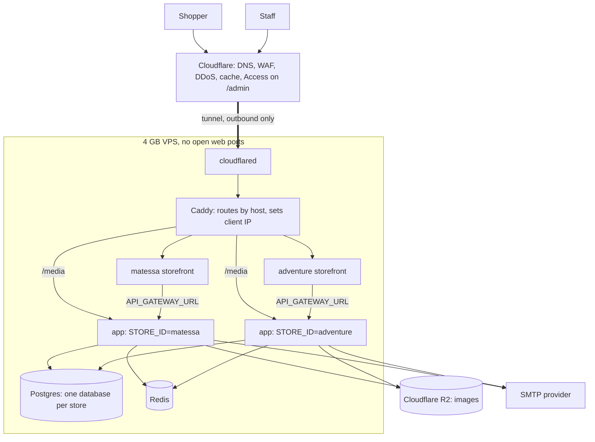

# Architecture

## 1. Shape



One image, started once per store. A store's copy knows one store id, connects to one database with
its own role, and shares no network with the other store's copy.

| Old system | New system |
|---|---|
| user, commercial, order services + gateway + Eureka (5 JVMs) | 1 app per store |
| Kafka | events stored in Postgres (Modulith event registry) |
| 3 databases, 2 schemas each | 1 database per store |
| MinIO | Cloudflare R2 |
| Feign, fallbacks, circuit breakers between services | method calls |
| stock reservation over HTTP, with expiry | one transaction |
| 1,311 lines of tenancy code | `STORE_ID` setting, about 40 lines |

## 2. Why one application

The old seams between processes had one adapter each, so they hid nothing and cost a network hop, a
timeout and a fallback every time. Stock and orders need to change together; putting them in one
database turns a saga into a transaction. Scale comes from caching reads, then running more copies of
the same app (section 8).

## 3. Layers

Root package `com.ecommerce.store`, packages by layer (ADR-0018).

| Package | Holds | May use |
|---|---|---|
| `controller` | `@RestController` classes: validate, call one service method, return a DTO. No logic, no transaction, no rate limiter | `service.interfaces`, `dto`, `model.enums`, `security` annotations |
| `service.interfaces` | What each service offers, one interface each (ADR-0019) | `model`, `dto` |
| `service.impl` | Business rules and transactions, one `<Interface>Impl` each, not public. Never the request or the token: `security.Caller` says who acts | `service.interfaces`, `repository`, `model`, `dto`, `exception`, `security`, `config` |
| `repository` | Spring Data interfaces and their queries | `model` |
| `model` | JPA entities | `model.enums` |
| `model.enums` | `Role`, `AddressType`, `OrderStatus`, `PaymentMethod`, `PaymentStatus`, `ShippingStatus`, `DiscountType`, `ContactQueryStatus` | nothing |
| `dto.request`, `dto.response` | Records. Request rules as Bean Validation, responses with a static `from(entity)` | `model` |
| `exception` | `ApiException` and the one `GlobalExceptionHandler` | `dto` |
| `security` | `SecurityConfig` with the access policy, tokens, request filter, rate limits, `Caller` | `repository` (reads accounts), `model`, `exception`, `config` |
| `config` | Settings, clock, Redis guard, cache and event configuration | `model`, `dto` |

A layer test (ArchUnit) fails the build when a controller touches a repository or the rate limiter, a
repository or entity looks upward, a DTO is not a record, a service is not an interface with its
implementation, a service sees the request or the token, a class other than the owner changes a table,
`@Transactional` appears outside `service.impl`, two packages depend on each other, time is read without
the `Clock`, or a text in a request has no maximum length.

### Features

The layers hold these features. The owner column is a rule, not a package: only that service changes the table (saves, deletes, updates, locks); others may read it.

| Feature | Services | Talks to |
|---|---|---|
| Accounts | `AuthService`, `RefreshTokenService`, `UserService`, `AddressService`, `StaffService` | |
| Catalog | `CategoryService`, `ProductService`, `VariantService`, `ProductImageService` | inventory, media |
| Inventory | `InventoryService`: `levels`, `take`, `putBack`, `setLevel` | |
| Promotions | `DiscountService`, `CouponService` | catalog |
| Pricing | `PricingService.quote`, stores nothing | catalog, promotions, inventory |
| Media | `MediaService` | |
| Cart | `CartService` | pricing |
| Payments | `PaymentService` | |
| Orders | `CheckoutService`, `OrderService` | cart, pricing, inventory, promotions, payments |
| Engagement | `ReviewService`, `WishlistService`, `ContactService`, `NewsletterService` | catalog, promotions |
| Analytics | `SalesAnalyticsService`, `CatalogAnalyticsService`, `CustomerAnalyticsService` | read-only SQL (ADR-0007) |
| Notifications | `NotificationService`, listens to stored events | |
| Audit | `AuditService` | |

Two services are worth protecting: `PricingService` (one call, whole basket) and `InventoryService` (three verbs hide locking,
ledger and idempotency). No cycles between services; Spring refuses to start on one.

### Seams with more than one adapter

Every service has an interface with one implementation. Only these have several:

| Seam | Adapters |
|---|---|
| `PaymentProvider` | cash on delivery; fake online (never in `prod`); Razorpay (phase 2) |
| `ObjectStore` | R2 (S3 protocol); local folder for development and tests |
| `Mailer` | SMTP; capturing fake for tests |
| `RateLimitStore` | Redis; local memory when Redis is down |

### Spring first

| Need | Comes from |
|---|---|
| Sign-in check, equal timing for unknown accounts | `AuthenticationManager` with `DaoAuthenticationProvider` |
| Verifying tokens, roles from the token | resource server auto-configuration (`spring.security.oauth2.resourceserver.jwt.*`) |
| Issuing tokens | `NimbusJwtEncoder` |
| Settings and refusing to start without them | `@ConfigurationProperties` with Bean Validation |
| Created and updated times | `@CreationTimestamp`, `@UpdateTimestamp` |
| Constructors, getters, builders, loggers | Lombok |
| Pages, sorting, size limits | Spring Data web support settings |
| Stored events | Spring Modulith event registry |

## 4. Layout

```
repository root
├── CONTEXT.md  README.md  docs/  .github/
├── frontend/                       Matessa storefront, frozen
├── deploy/  compose.yml  Caddyfile  postgres/  redis/  backup/  deploy.sh
└── backend/
    ├── pom.xml  mvnw  Dockerfile  compose.yaml
    ├── src/main/java/com/ecommerce/store/
    │   ├── StoreApplication.java
    │   ├── controller/   AuthController ...
    │   ├── service/      interfaces/  AuthService ...   impl/  AuthServiceImpl ...
    │   ├── repository/   UserRepository ...
    │   ├── model/        User, RefreshToken ...   enums/  Role, PaymentMethod ...
    │   ├── dto/          request/  response/
    │   ├── exception/    ApiException, GlobalExceptionHandler
    │   ├── security/     SecurityConfig, JwtService, RequestFilter ...
    │   └── config/       StoreProperties, CacheConfig, RedisGuard ...
    ├── src/main/resources/application.yaml  db/migration/
    └── src/test/java/...  contract/ reads docs/
```

## 5. A request, start to finish

1. Cloudflare applies WAF, DDoS and, on `/admin`, Access. The tunnel delivers it to Caddy.
2. Caddy replaces `X-Real-IP` and `X-Forwarded-For` with the visitor address Cloudflare reported, and sends
   `/media/*` to the app and everything else to the storefront.
3. The storefront's BFF checks its allow-list, adds the token from the httpOnly cookie, `X-Tenant-ID` and
   the client address, and calls `http://<store>-app:8080`.
4. App, in order: request id → store check (400) → whole-store limit (503) → JWT (401; 403 for another
   store's token) → access policy (401 or 403) → rate limits (429).
5. Controller: validates the DTO, calls one service method, returns a DTO. No logic.
6. Service: short transaction, or a cache answer.
7. After commit: cache entries cleared, events delivered in the background.

`X-Tenant-ID` must equal `STORE_ID`. The storefronts already send it. It stays as a safety check that a
storefront is wired to the right app; the JWT still carries a `tenant` claim with the store id.

## 6. Events

Spring application events with `@ApplicationModuleListener`, stored by the Modulith JDBC event registry in
the same transaction as the change. Delivered after commit on a separate thread; retried on startup and
every 5 minutes if incomplete. Listeners must tolerate running twice.

| Event | Published by | Listeners |
|---|---|---|
| `OrderPlaced` | orders | notifications (confirmation) |
| `OrderStatusChanged` | orders | notifications (shipped, delivered) |
| `OrderCancelled` | orders | notifications |
| `StockLow` | inventory | notifications (staff mail, at most one per variant per day) |
| `Subscribed` | engagement | notifications (welcome coupon mail) |
| `StaffCreated` | accounts | notifications |

Stock and coupons are **not** event-driven: they change inside the order's transaction. Neither are audit entries (same transaction) and
cache clearing (after commit, on the same thread).

## 7. Runtime choices

- **Threads:** 50 platform threads, virtual threads off (ADR-0013). The connection pool (10 per app) is the real concurrency limit; wait at most 5 s.
- **Timeouts**: SMTP 10 s, R2 5 s connect and 15 s total. Both are only called outside transactions.
- **Circuit breaker** (`resilience4j-circuitbreaker`) and Spring's `@Retryable` only where the network is real: R2, SMTP, and Razorpay in phase 2.
- **Image decoding** limited to one at a time per app (a 4096 px image needs about 64 MB).
- **Graceful shutdown** 25 s. Liveness and readiness probes; readiness needs Postgres, not Redis.
- **Time** is UTC in the database. The India time zone is used only for order numbers and analytics months.
- **Observability**: JSON logs with request id and store; Micrometer metrics on a private port; slow-query
  log at 300 ms; an external uptime check on `/` and on a health URL through the tunnel.

## 8. Scaling path

Move one step when its trigger is real. Each step is configuration, not a rewrite.

| Step | Trigger | Change |
|---|---|---|
| 0 | Launch | 4 GB VPS, one copy per store, cache and edge caching |
| 1 | Third store, or memory above 85% | Resize to 8 GB |
| 2 | Deploys must not interrupt, or CPU above 70% | Two copies per store behind Caddy. Already safe: no state in memory, jobs use ShedLock, limits in Redis |
| 3 | Database is the bottleneck or backups matter more | Managed Postgres; add a read replica for analytics |
| 4 | One feature has a different load or team | Extract its services and tables; its events move to a broker |

Not before step 4: Kafka, Kubernetes, a second service.

## 9. What is deliberately absent

Service discovery, API gateway, message broker, distributed tracing backend on the VPS, GraphQL, WebSocket,
shared libraries, schema-per-store routing. Each was considered; see `adr/`.
