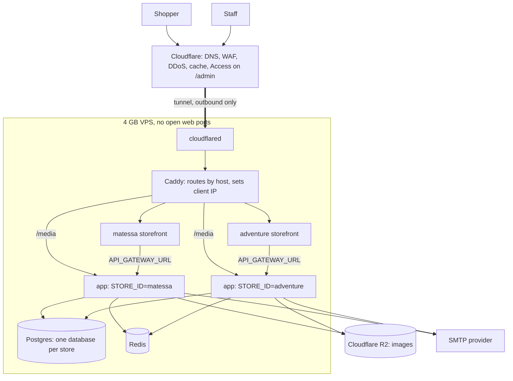
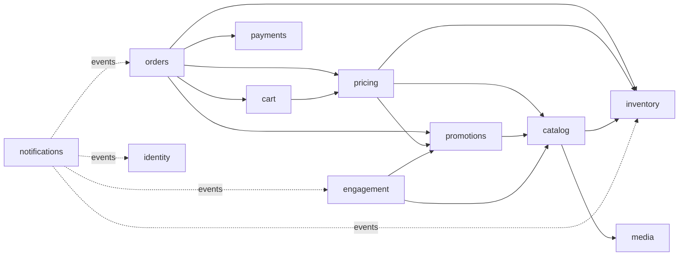

# Architecture

## 1. Shape



One image, started once per store. A store's copy knows one store id, connects to one database with
its own role, and shares no network with the other store's copy.

| Old system | New system |
|---|---|
| user, commercial, order services + gateway + Eureka (5 JVMs) | 1 app per store |
| Kafka | events stored in Postgres (Modulith event registry) |
| 3 databases, 2 schemas each | 1 database per store |
| MinIO | Cloudflare R2 |
| Feign, fallbacks, circuit breakers between services | method calls |
| stock reservation over HTTP, with expiry | one transaction |
| 1,311 lines of tenancy code | `STORE_ID` setting, about 40 lines |

## 2. Why a modular monolith

The old seams between processes had one adapter each, so they hid nothing and cost a network hop, a
timeout and a fallback every time. Stock and orders need to change together; putting them in one
database turns a saga into a transaction. The walls between modules stay, enforced by the build.

Scale comes from caching reads, then running more copies of the same app (section 8). Splitting a
module out later is possible because modules already talk only through interfaces and events.

## 3. Modules

Root package `com.ecommerce.store`. Each module is one package. Types in the module's root package are its
interface; `internal` is private. Spring Modulith verifies this in the build.

| Module | Owns | Interface (what other modules may use) |
|---|---|---|
| `platform` (open) | Errors, web setup, access policy, JWT, rate limit, cache, store id, clock | `ApiError` exceptions, `CurrentUser`, `StoreId`, `AfterCommit`, `CacheNamespace` |
| `identity` | Users, roles, addresses, refresh tokens, login hardening | `Users.emailOf(id)`, events `StaffCreated`, `UserDisabled` |
| `catalog` | Categories, products, variants, product images | `Catalog.variants(ids)`, `Catalog.categoryPath(productId)`, event `CatalogChanged` |
| `inventory` | Stock levels, stock movements | `Inventory.levels(ids)`, `take(ref, lines)`, `putBack(ref, reason)`, `setLevel(variantId, qty, actor)`, event `StockLow` |
| `promotions` | Discounts, coupons, redemptions | `Promotions.bestDiscounts(products)`, `checkCoupon`, `claimCoupon(code, customer, orderRef)`, `returnCoupon(orderRef)`, `mintWelcomeCoupon()` |
| `pricing` | Nothing stored | `Pricing.quote(lines, coupon)`, `Pricing.prices(variantIds)` |
| `media` | Image bytes | `Media.storeAsWebp(upload)`, `Media.read(key)` |
| `cart` | Carts | `Carts.lines(userId)`, `Carts.clear(userId)` |
| `payments` | Payment attempts | `Payments.methods()`, `Payments.start(order)` |
| `orders` | Orders, items, history, idempotency, checkout | events `OrderPlaced`, `OrderStatusChanged`, `OrderCancelled` |
| `engagement` | Reviews, wishlists, contact queries, subscribers | event `Subscribed` |
| `analytics` | Materialized views | Endpoints only |
| `notifications` | Sent-mail log | Listens to events, sends email |
| `audit` | Audit entries | Nothing to call. It acts on `@Audited` (declared in `platform`) |



Notes:
- `cart` needs stock for display. It asks `pricing.prices`, which returns price and stock together.
- `promotions` needs `catalog.categoryPath`; `catalog` never needs `promotions`. Effective prices on the
  variant list are composed by the catalog web layer through a small interface implemented by `pricing`
  (`EffectivePrices`, declared in `catalog`), so there is no cycle.
- The two deep modules worth protecting are `pricing` (one call, whole basket) and `inventory` (three verbs
  hide locking, ledger and idempotency).

### Seams with more than one adapter

Only these get a Java interface with several implementations:

| Seam | Adapters |
|---|---|
| `PaymentProvider` | cash on delivery; fake online (never in `prod`); Razorpay (phase 2) |
| `ObjectStore` | R2 (S3 protocol); local folder for development and tests |
| `Mailer` | SMTP; capturing fake for tests |
| `RateLimitStore` | Redis; local memory when Redis is down |

Everything else is a class. Do not add `XService` + `XServiceImpl` pairs.

## 4. Layout to aim for

```
repository root
├── CONTEXT.md  README.md  docs/  .github/
├── frontend/                       Matessa storefront, frozen
├── deploy/  compose.yml  Caddyfile  postgres/  redis/  backup/  deploy.sh
└── backend/
    ├── pom.xml  mvnw  Dockerfile  compose.yaml
    ├── src/main/java/com/ecommerce/store/
    │   ├── StoreApplication.java
    │   ├── platform/  identity/  catalog/  inventory/  promotions/  pricing/
    │   ├── media/  cart/  payments/  orders/  engagement/
    │   └── analytics/  notifications/  audit/
    │         e.g. orders/Orders.java, OrderPlaced.java          (interface)
    │              orders/internal/web/OrderController.java
    │              orders/internal/Checkout.java, OrderRepository.java, ...
    ├── src/main/resources/application.yaml  db/migration/
    └── src/test/java/...  src/test/resources/contract/*.json
```

## 5. A request, start to finish

1. Cloudflare applies WAF, DDoS and, on `/admin`, Access. The tunnel delivers it to Caddy.
2. Caddy replaces `X-Real-IP` and `X-Forwarded-For` with the visitor address Cloudflare reported, and sends
   `/media/*` to the app and everything else to the storefront.
3. The storefront's BFF checks its allow-list, adds the token from the httpOnly cookie, `X-Tenant-ID` and
   the client address, and calls `http://<store>-app:8080`.
4. App filters, in order: request id → store check (400) → rate limit (429) → JWT (401; 403 for another
   store's token) → access policy (401 or 403).
5. Controller: validates the DTO, calls one module method, returns a DTO. No logic.
6. Module: short transaction, or a cache answer.
7. After commit: cache entries cleared, events delivered in the background.

`X-Tenant-ID` must equal `STORE_ID`. The storefronts already send it. It stays as a safety check that a
storefront is wired to the right app; the JWT still carries a `tenant` claim with the store id.

## 6. Events

Spring application events with `@ApplicationModuleListener`, stored by the Modulith JDBC event registry in
the same transaction as the change. Delivered after commit on a separate thread; retried on startup and
every 5 minutes if incomplete. Listeners must tolerate running twice.

| Event | Published by | Listeners |
|---|---|---|
| `OrderPlaced` | orders | notifications (confirmation), audit trail |
| `OrderStatusChanged` | orders | notifications (shipped, delivered) |
| `OrderCancelled` | orders | notifications |
| `StockLow` | inventory | notifications (staff mail, at most one per variant per day) |
| `Subscribed` | engagement | notifications (welcome coupon mail) |
| `StaffCreated`, `UserDisabled` | identity | audit, token denial |
| `CatalogChanged` | catalog, promotions | cache clearing |

Stock and coupons are **not** event-driven. They change inside the order's transaction.

## 7. Runtime choices

- **Threads:** 50 platform threads, virtual threads off (ADR-0013). The connection pool (10 per app) is the real concurrency limit; wait at most 5 s.
- **Timeouts**: SMTP 10 s, R2 5 s connect and 15 s total. Both are only called outside transactions.
- **Circuit breaker** (`resilience4j-circuitbreaker`) and Spring's `@Retryable` only where the network is real: R2, SMTP, and Razorpay in phase 2.
- **Image decoding** limited to one at a time per app (a 4096 px image needs about 64 MB).
- **Graceful shutdown** 25 s. Liveness and readiness probes; readiness needs Postgres, not Redis.
- **Time** is UTC in the database. The India time zone is used only for order numbers and analytics months.
- **Observability**: JSON logs with request id and store; Micrometer metrics on a private port; slow-query
  log at 300 ms; an external uptime check on `/` and on a health URL through the tunnel.

## 8. Scaling path

Move one step when its trigger is real. Each step is configuration, not a rewrite.

| Step | Trigger | Change |
|---|---|---|
| 0 | Launch | 4 GB VPS, one copy per store, cache and edge caching |
| 1 | Third store, or memory above 85% | Resize to 8 GB |
| 2 | Deploys must not interrupt, or CPU above 70% | Two copies per store behind Caddy. Already safe: no state in memory, jobs use ShedLock, limits in Redis |
| 3 | Database is the bottleneck or backups matter more | Managed Postgres; add a read replica for analytics |
| 4 | One module has a different load or team | Extract it along its interface; its events move to a broker |

Not before step 4: Kafka, Kubernetes, a second service.

## 9. What is deliberately absent

Service discovery, API gateway, message broker, distributed tracing backend on the VPS, GraphQL, WebSocket,
shared libraries, schema-per-store routing. Each was considered; see `adr/`.
