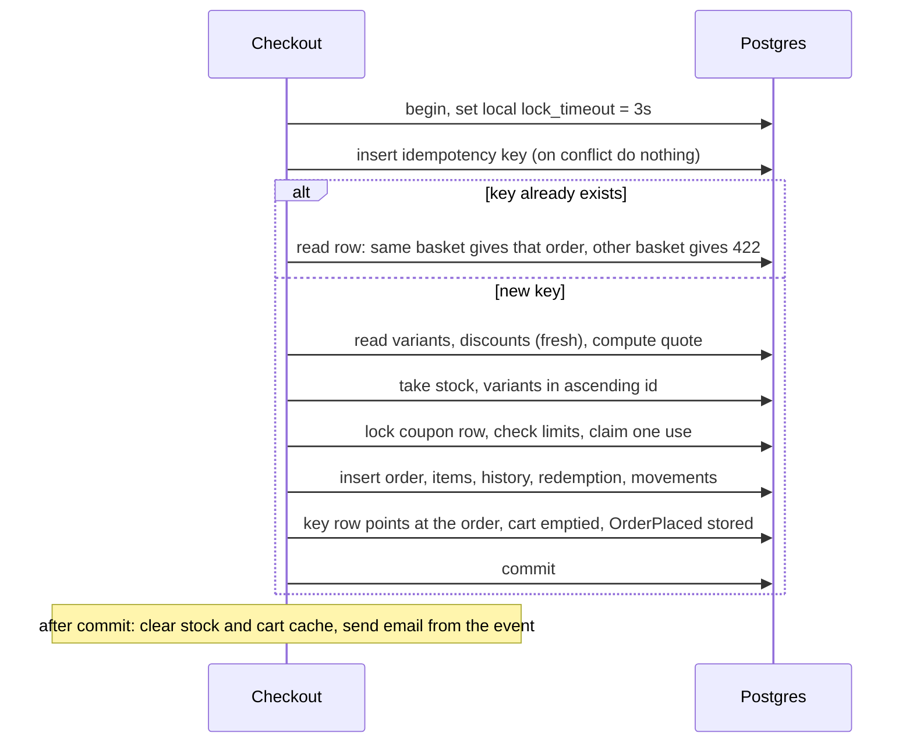
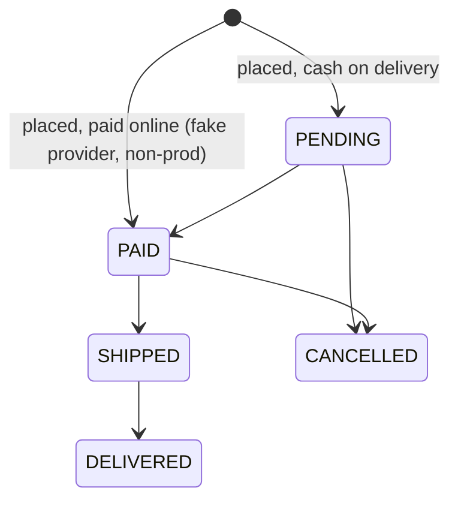

# Checkout and orders

Money and stock. The strictest document in this repository.

## 1. Pricing rules

1. List price = variant `priceOverride`, else product `basePrice`.
2. Candidate discounts = active ones, inside their dates, on the product or on any category in its path.
3. Effective price = list price after the **single** discount that gives the lowest price. Never below 0. Two decimals, `HALF_UP`.
   Percentage: `list - list × value / 100` (the reduction is rounded to two decimals first). Fixed: `list - value`.
4. Subtotal = sum of effective price × quantity.
5. Coupon amount: percentage of the subtotal, or the fixed value, never more than the subtotal.
6. Total = subtotal − coupon amount, never below 0.
7. Shipping and tax are not charged separately today; prices are treated as tax-inclusive. The response has
   no field for them, so adding them is a phase 2 contract change.

Limits: 1 to 20 units per line, at most 50 lines. Duplicate lines for a variant are merged before any check.

`Pricing.quote` is the only place these rules live. Cart, `POST /api/cart/price`, coupon preview and
checkout all call it. Cart and preview may use cached inputs. **Checkout passes fresh rows.**

## 2. Checkout, cash on delivery

One transaction, no network calls inside it.



Stock is taken with a guarded update, so the database decides who gets the last unit:

```sql
update stock_levels
   set quantity = quantity - :qty, version = version + 1
 where variant_id = :id and quantity >= :qty;   -- 0 rows: not enough, answer 409
```

Any exception rolls everything back: stock, coupon, key and order. There is nothing to compensate.

### Idempotency

| Situation | Answer |
|---|---|
| No key sent | Order is placed (the storefronts always send one) |
| New key | Order is placed |
| Same key, same requester, same basket | `201` with the original order |
| Same key, different basket or details | `422`, code `IDEMPOTENCY_KEY_REUSED` |
| Same key while the first is still running (lock timeout) | `409`, code `REQUEST_IN_PROGRESS` |
| Key belongs to another requester | `409`, no detail |
| Key longer than 80 characters | `400` |

- Requester is `u:<userId>` or `e:<lower-cased email>`. The hash is SHA-256 over merged lines, address, payment method, coupon and shipping method.
- A signed-in retry after success arrives with an empty cart. Look the finished key up **first** and rebuild the lines from that order's items. (The old system had this bug.)
- Keys are purged after 24 h.
- **Unknown commit result** (connection lost while committing): answer `409` `REQUEST_IN_PROGRESS`, never 5xx. The storefront treats every other answer as "no order exists" and frees the key.

### Errors the storefront relies on

`400` empty cart or validation · `409` out of stock, unavailable variant, coupon not applicable · `422` key reused · `429` limited.

## 3. Order states



- Only these moves are legal; anything else is `400` ("Illegal status transition").
- Moving to PAID with payment `PENDING` sets payment `COMPLETED`. Moving to SHIPPED or DELIVERED sets the shipping status.
- Cancelling: the customer (own order) or staff; not after SHIPPED (`409`); twice is `409`. Puts stock back, returns the
  coupon use, and sets payment `REFUNDED` if it was `COMPLETED`. All in one transaction.
- Every move writes `order_status_history`. `@Version` on the order makes simultaneous edits a `409`.

**Known oddity kept on purpose:** the admin screen's "Mark dispatched" button is PENDING to PAID, so cash on
delivery counts as revenue at dispatch, before the cash is collected. Screens are frozen in v1. Phase 2: allow
PENDING to SHIPPED for cash on delivery and mark payment at DELIVERED.

## 4. Stock rules

- Only `inventory` writes stock. Each change adds a `stock_movement` with a reason:
  `SALE`, `CANCEL`, `HOLD_EXPIRED`, `STAFF_EDIT`, `INITIAL`.
- `take` and `putBack` carry the order as reference. A unique index on (reference, variant, reason) makes repeats harmless.
- Invariant, checked by a nightly job and by tests: for each variant, the sum of movements equals the level.
- Staff edits set an absolute number, because the frozen screen sends one. A sale that happens between opening
  and saving the form is overwritten. Mitigation in v1: the edit locks the row, writes the difference as a movement
  with before and after, and raises an audit entry, so the loss is visible. Phase 2 adds `expectedStock` to the request and answers `409`.
- First real variant deactivates the default variant. Removing the last real one reactivates it at stock 0.
- A level at or below the variant's `restockLevel` after a sale publishes `StockLow`. No `restockLevel`, no alert.

## 5. Coupons

- Valid when active, within dates, below `maxUses`, and subtotal at least `minSpend`.
- At checkout the coupon row is locked, the customer's earlier redemptions are counted against `perUserLimit`
  (by user id, or by email for guests), then one use is claimed with a guarded update.
- `POST /api/coupons/validate` is a preview and never consumes a use.
- Welcome code: `WELCOME15-` plus six characters from `ABCDEFGHJKLMNPQRSTUVWXYZ23456789`, from `SecureRandom`
  (the old code used a predictable generator).

## 6. Order numbers

Store prefix (first two letters, upper case) + `yyMMdd` in `Asia/Kolkata` + `-` + six random Crockford base-32
characters. Unique index; retry on collision. Tracking needs the number **and** the email.

## 7. Phase 2: Razorpay

Designed now so the tables and interfaces fit. Not built in v1.

1. Checkout with `ONLINE`: same transaction, but the order is PENDING with `hold_expires_at = now + 15 min`.
   Stock and coupon are taken.
2. After commit, create the Razorpay order (amount in paise, our order number as receipt). If that call fails,
   the order is cancelled and stock put back.
3. The storefront opens the payment popup (**this needs a storefront change**).
4. `POST /api/payments/razorpay/webhook`: verify the HMAC-SHA256 signature over the raw body with a constant-time
   comparison, ignore event ids already seen, then move the order to PAID only if amount and currency match.
5. The browser's success callback is a hint. **Only the webhook (or our own status query) marks an order paid.**
6. A job cancels orders whose hold expired, after asking Razorpay for the final status.
7. A payment that arrives after expiry is refunded automatically and reported to staff.
8. Refunds go through the provider; `REFUNDED` is set only on the refund webhook.

Cloudflare note: Bot Fight Mode must be off, or the webhook may be challenged (`CLOUDFLARE.md`).
